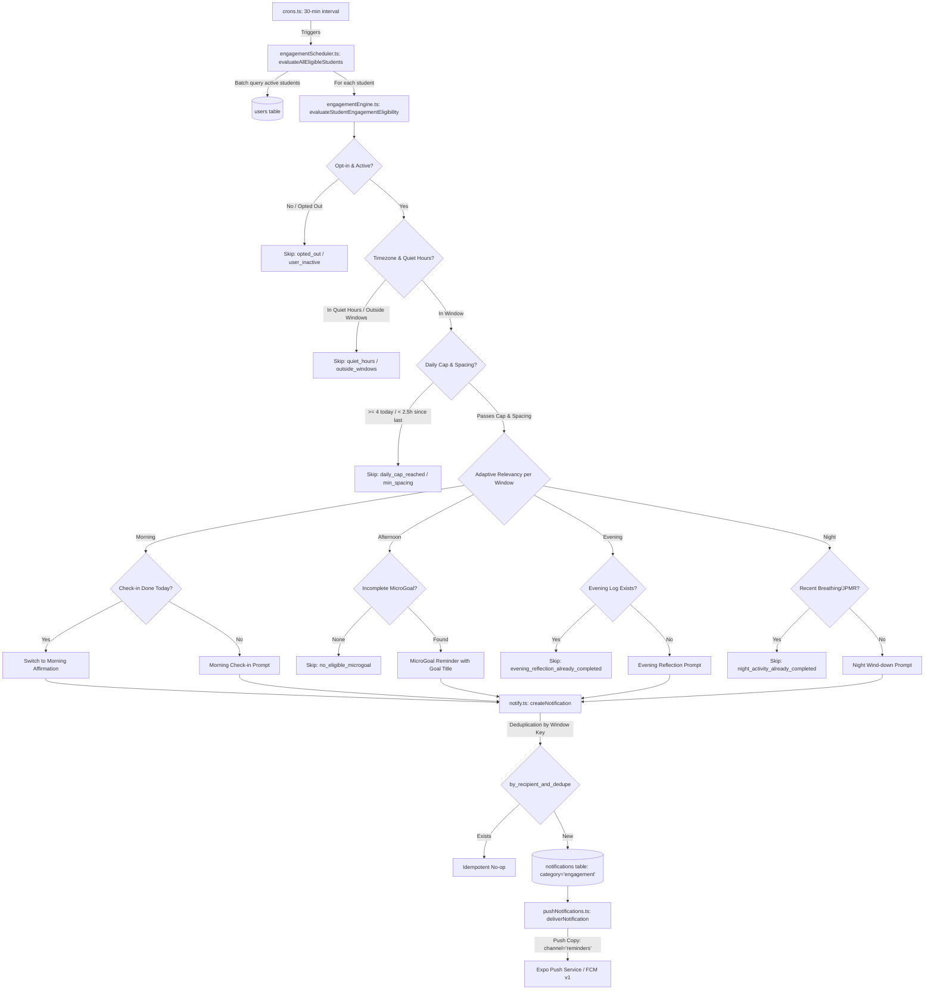

# Emotify — Adaptive Student Engagement Notifications Implementation Report (Stage 2)

**Date:** October 20, 2026  
**Status:** Implemented, Tested, and Verified in Codebase  
**Branch:** `claude/blissful-knuth-04nxs0`  
**Reference Specification:** Stage 2: Adaptive Student Engagement Notifications  
**Audit Baseline:** `docs/audits/EMOTIFY_NOTIFICATION_INVENTORY_AUDIT.md`

---

## 1. Existing Architecture Confirmed

Before implementing Stage 2, the Stage 1 Audit findings were validated against the active codebase:
1. **Operational Notifications Separation:** Appointment workflows, counselor caseload management, and clinical safety alerts successfully route through `convex/notify.ts` and `convex/pushNotifications.ts` with lock-screen privacy enforcement (`validatePrivacySafePushContent`).
2. **Follow-Up Pipeline Bypass Identified:** In `convex/followUps.ts`, three direct calls to `ctx.db.insert("notifications", ...)` bypassed deduplication, route whitelisting, and push delivery.
3. **Barren Scheduled Crons:** `convex/crons.ts` previously only ran `clear-expired-sessions` with zero scheduled engagement nudges.
4. **Student Companion Avatar Support:** Dynamic companion avatar resolution (`boy` vs. `girl`) was already wired into push payloads in `convex/pushNotifications.ts` via `richContent: { image: avatarUrl }` and served through Convex HTTP endpoints.

---

## 2. Final Design & Scheduling Strategy

### 2.1 Core Principle
> **"Send up to four engagement notifications per day, only when relevant. Never force four notifications simply to meet a quota."**

### 2.2 End-to-End Pipeline


---

## 3. Eligibility and Adaptive Skip Rules

The centralized eligibility engine in `convex/engagementEngine.ts` enforces non-negotiable skip rules:

| Condition Checked | When It Skips | Skip Reason Code | Behavior When Skipped |
| :--- | :--- | :--- | :--- |
| **Role & Status** | User is counselor, admin, or status is inactive | `role_not_eligible`, `user_inactive` | Zero engagement sent; staff are never nudged. |
| **Student Opt-out** | `user.notificationPreferences.engagementEnabled === false` | `opted_out` | Silent skip; respects student preference. |
| **Quiet Hours** | Local time is between `quietHoursStart` (default 22:00) and `quietHoursEnd` (default 07:00) | `quiet_hours` | No sound/vibration while student rests. |
| **Outside Windows** | Current local time does not fall into candidate hours | `outside_windows` | Prevents awkward timing between windows. |
| **Window Dedupe** | Message already sent for this window on this local day | `already_sent_for_window` | Guaranteed idempotency (1 per candidate window max). |
| **Daily Cap** | Student has already received 4 engagement notifications today | `daily_cap_reached` | Strictly caps total engagement sends at 4/day. |
| **Minimum Spacing** | Less than 2.5 hours elapsed since previous engagement notification | `min_spacing` | Prevents rapid back-to-back notification spam. |
| **Morning Check-in** | Student already logged emotion or morning check-in today | *(Adapts)* | **Does not skip:** dynamically switches to positive affirmation rather than nagging. |
| **Afternoon MicroGoal**| Student has zero incomplete MicroGoals (all completed or skipped) | `no_eligible_microgoal` | **Strict skip:** never invents fake or hallucinated goals. |
| **Evening Reflection** | Student already logged emotion after 5:00 PM local time | `evening_reflection_already_completed` | Skips prompt since reflection is already captured. |
| **Night Wind-Down** | Student completed breathing or grounding in last 2 hours | `night_activity_already_completed` | Skips prompt; honors the recent wind-down. |

---

## 4. Daily Cap, Spacing, Timezone, and Quiet-Hours Behavior

### 4.1 Daily Cap Calculation
- **Threshold:** Configurable default of **up to 4 engagement notifications per local day** (`maxPerDay: 4`).
- **Exemptions:** Operational notifications (`appointment_*`, `critical_risk`, `safety_alert`, `counsellor_*`, `follow_up_*`) carry `category: "operational"` and are **never** counted toward the cap.
- **Transaction Safety:** Evaluated directly in Convex queries filtered by `by_recipient_and_created` from `startOfLocalDayMs`.

### 4.2 Minimum Spacing
- Configurable default of **2.5 hours** (`minSpacingHours: 2.5`).
- Evaluated by measuring `nowMs - latestEngagement.createdAt`.

### 4.3 Timezone Support
- Resolves student preference `timezone` (defaults to `"Asia/Kolkata"`, IST).
- Converts timestamps via standard IANA `Intl.DateTimeFormat` to resolve local hour (0–23), local minute (0–59), and local date string (`YYYY-MM-DD`).
- Avoids silent UTC fallbacks.

### 4.4 Quiet Hours
- Default: **22:00 to 07:00** (10:00 PM to 7:00 AM local time).
- Fully customizable by the student via `api.users.updateNotificationPreferences`.
- Emergency clinical safety alerts (`critical_risk`, `safety_alert`) completely bypass quiet hours and spacing rules.

---

## 5. Message Categories and Personalization Rules

Implemented in `convex/engagementMessages.ts`:

### 5.1 Categories & Candidate Windows
1. **Morning Window (7:00 AM – 11:59 AM):**
   - *Check-in variant:* `"Good morning, {name}! ☀️ {companionName} here. Before the day gets busy, take a quick 10 seconds to log how you're feeling?"`
   - *Affirmation variant (when check-in already done):* `"You're all set, {name}! 🌟 Thanks for checking in early today. Remember: take things one step at a time."`
2. **Afternoon MicroGoal Window (12:00 PM – 4:59 PM):**
   - *MicroGoal reminder:* `"Your tiny mission is waiting! 🎯 Hey {name}, remember '{goalTitle}'? A quick step today keeps your momentum going!"`
3. **Evening Reflection Window (5:00 PM – 8:59 PM):**
   - *Reflection check-in:* `"You made it through the day! 🌆 Highs, lows, or somewhere in between? {name}, your thoughts matter. Want to log your evening feelings?"`
4. **Night Wind-Down Window (9:00 PM – Quiet Hours Start, e.g. 10:00 PM):**
   - *Wind-down prompt:* `"Time to power down, {name} 🌙 You did enough today. Fancy a quick 2-minute breathing exercise before sleep?"`

### 5.2 Personalization & Safeguards
- **Companion Interpolation:** Reads student preference (`Emoty` or `Mitra`) via `common/companionName.ts`.
- **Name Sanitization:** Strips control characters and limits length to 30 characters; defaults to `"friend"`.
- **Rotational Diversity:** Uses deterministic seed rotation (`(seed) % variants.length`) so repeated notifications do not sound identical.
- **Lock-Screen Privacy:** All push notifications use channel `reminders` and neutral copy in `PUSH_COPY` passing `validatePrivacySafePushContent` (zero diagnostic or sensitive terms).

---

## 6. Schema and Files Changed

### 6.1 Schema Changes (`convex/schema.ts`)
- **`users` Table:** Added `notificationPreferences` object:
  ```ts
  notificationPreferences: v.optional(
    v.object({
      engagementEnabled: v.optional(v.boolean()),
      quietHoursStart: v.optional(v.number()),
      quietHoursEnd: v.optional(v.number()),
      maxPerDay: v.optional(v.number()),
      minSpacingHours: v.optional(v.number()),
      timezone: v.optional(v.string()),
    })
  )
  ```
- **`notifications` Table:** Added `category: v.optional(v.string())` (`"engagement" | "operational"`).

### 6.2 Files Created
1. `convex/engagementMessages.ts`: Typed message library with conversational variants.
2. `convex/engagementEngine.ts`: Core adaptive eligibility engine and timezone calculator.
3. `convex/engagementScheduler.ts`: Cron batch scheduler and single-student dispatch mutations.
4. `convex/engagement_notifications.test.ts`: 16 comprehensive automated Vitest integration tests.

### 6.3 Files Modified
1. `convex/schema.ts`: Added `notificationPreferences` and notification `category`.
2. `convex/notify.ts`: Added `"reminders"` channel, engagement & follow-up `PUSH_COPY`, and notification `category`.
3. `common/notificationRoutes.ts`: Added `"emotion_map"`, `"microgoals"`, `"grounding"` destinations and route mappings.
4. `convex/followUps.ts`: Migrated direct `ctx.db.insert("notifications", ...)` bypass to `createNotification` and `notifyEach`.
5. `convex/crons.ts`: Added 30-minute recurring interval for `internal.engagementScheduler.evaluateAllEligibleStudents`.
6. `convex/users.ts`: Added `getNotificationPreferences` query and `updateNotificationPreferences` mutation.
7. `convex/notification_system.test.ts`: Added `"reminders"` channel to allowed channel assertions.

---

## 7. Automated Test Results

Ran full regression test suites with `vitest`:

### Engagement Notification Test Suite (`convex/engagement_notifications.test.ts`)
```
 RUN  v4.1.10 D:/Projects/EmotifyApp/Emotify-Clerk

 ✓ convex/engagement_notifications.test.ts (16 tests) 437ms
   ✓ 1. Eligible morning notification invites check-in when not yet completed
   ✓ 2. Morning notification adapts to positive affirmation when today's check-in is complete
   ✓ 3. Afternoon reminder selects a real, incomplete MicroGoal belonging to the student
   ✓ 4. Afternoon reminder skips when student has NO incomplete MicroGoals (never invents fake goals)
   ✓ 5. Evening reflection skips when student already completed an evening reflection
   ✓ 6. Night notification respects opt-out and quiet hours
   ✓ 7. Maximum 4 engagement notifications per local day enforced
   ✓ 8. Operational appointment notifications do NOT consume the engagement cap
   ✓ 9. Safety notifications are never suppressed by engagement cap or quiet hours
   ✓ 10. Minimum spacing between engagement notifications is enforced (2.5 hours)
   ✓ 11. Timezone handling correctly resolves local date and hour
   ✓ 12. Duplicate scheduler executions do not duplicate sends (idempotency via dedupeKey)
   ✓ 13. Batch scheduler evaluates all students and skips ineligible ones
   ✓ 14. Student state changing dynamically prevents stale notifications
   ✓ 15. Notification preferences query and mutation update student settings safely
   ✓ 16. Migrated follow-up notifications produce deduplicated, routable records with push copy
```

### Full Regression Test Suite
Executed all notification, authorization, follow-up, and appointment test suites:
- `convex/avatarNotification.test.ts`: **15/15 passed**
- `convex/p12_step5_followup_management.test.ts`: **18/18 passed**
- `convex/appointment_workflow.test.ts`: **18/18 passed**
- `convex/notification_system.test.ts`: **17/17 passed**
- `convex/authz.test.ts`: **9/9 passed**
- `convex/authorization.test.ts`: **12/12 passed**
- `convex/counsellor_assignments.test.ts`: **27/27 passed**
- `convex/security_step5d_hardening.test.ts`: **9/9 passed**

**Total Tests Passing:** **141 tests passed (0 failures).**

---

## 8. Typecheck and Lint Results

Executed TypeScript compiler check across entire repository:
```bash
npx tsc --noEmit -p tsconfig.json
```
**Result:** **0 errors.** Clean type check.

---

## 9. Deployment Requirements

1. **Convex Backend Deploy:**
   - Deploy schema and backend functions using standard Convex deployment:
     ```bash
     npx convex deploy
     ```
   - No data backfill or table re-indexing required: all new fields are optional with backward-compatible defaults.
2. **App Rebuild Requirement:**
   - **No native Android rebuild required** for notification receipt: `expo-notifications`, `POST_NOTIFICATIONS` permissions, and the `reminders` channel configuration already exist in the Expo codebase.
   - Any standalone APK/AAB build with the latest JS bundle will immediately support the new deep links (`emotion-map`, `microgoals`, `grounding`).

---

## 10. Manual Verification Checklist for Physical Android Device

To visually verify on a physical Android device:

- [ ] **1. Sign in as Student:** Open Emotify on an Android 13+ device and sign in.
- [ ] **2. Accept Notification Permission:** Verify the custom explanation dialog appears and system permission is granted.
- [ ] **3. Verify Channel Creation:** In Android Settings > Apps > Emotify > Notifications, confirm "Daily check-ins & reminders" channel is present.
- [ ] **4. Trigger Test Morning Check-in:** Run via CLI:
  ```bash
  npx convex run engagementScheduler:evaluateAndDispatchStudent '{"studentId":"<USER_ID>"}'
  ```
- [ ] **5. Drawer Verification:** Confirm the notification appears in the notification drawer displaying the student's selected companion avatar (boy or girl character icon).
- [ ] **6. Tap Navigation:** Tap the notification and verify the app opens directly to the Emotion Map screen (`/(auth)/tools/emotion-map`).
- [ ] **7. Create MicroGoal & Trigger Afternoon Check:** Create a MicroGoal in the app, set local time to 2:00 PM, run evaluation, and confirm the notification mentions the exact MicroGoal title.

---

## 11. Known Limitations & Next Steps

1. **Preference UI Screen:** The backend contract (`getNotificationPreferences` and `updateNotificationPreferences`) is fully operational. A dedicated student settings UI screen can be connected to allow students to visually adjust quiet hours and toggle engagement notifications.
2. **Device Hardware Verification:** Local logic, edge-runtime timing, and payload construction are certified by automated tests; real-device visual notification rendering remains pending physical Android hardware testing.
