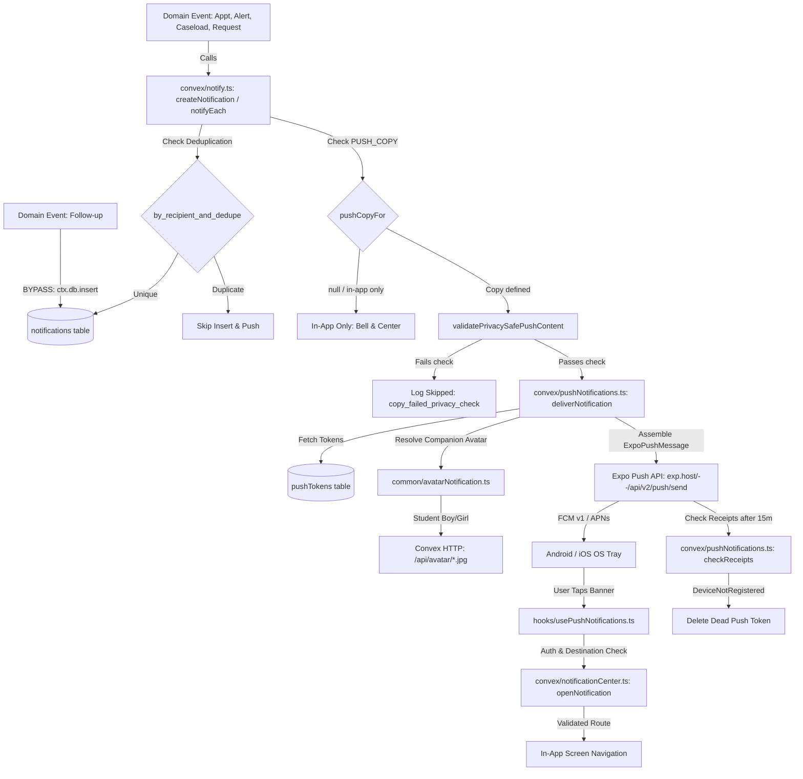

# Emotify — Comprehensive Notification Inventory Audit (Stage 1)

**Audit Date:** October 20, 2026  
**Auditor:** Antigravity AI  
**Branch:** `claude/blissful-knuth-04nxs0`  
**Repository State:** Clean working tree (Commit `4c953ef` — *Implement student companion avatar display in Android push notifications*)  
**Scope:** Read-only architectural and functional inventory audit across all notification paths, backend triggers, client handlers, and background jobs.

---

## 1. Executive Summary

This Stage 1 Audit establishes an evidence-based, code-level inventory of every notification implemented in the Emotify codebase before initiating Stage 2 (Notification Engagement Redesign).

### Key Findings at a Glance

1. **Safety and Clinical Notification Core is Robust:** The platform has a mature, privacy-preserving notification pipeline for appointments, counselor assignments, counselor requests, and acute safety alerts.
2. **24 Distinct In-App Notification Types Identified:**
   - 13 Appointment workflow notifications
   - 5 Counselor caseload and assignment notifications
   - 2 Safety alert notifications (critical risk & safety alert)
   - 2 Counselor support request notifications
   - 2 Care follow-up notifications (direct DB insert bypass)
3. **1 External Emergency Channel Identified:** Automated Twilio SMS dispatch for emergency contacts upon critical safety alerts (`suicide`, `suicideRisk`, `psychosis`, `psychosisRisk`).
4. **Daily Engagement & Gamification Notifications are 0% Implemented:**
   - Zero daily emotion check-in reminders.
   - Zero positive affirmations or conversational encouragement (Zomato-style).
   - Zero micro-goal or streak reminder notifications.
   - Zero guided meditation, breathing, or grounding reminders.
   - Zero proactive companion (Emoty/Mitra) re-engagement pushes.
   - `convex/crons.ts` contains only a daily session cleanup job (`clear-expired-sessions`).
5. **Architectural Bypass Discovered in Follow-ups:** `convex/followUps.ts` bypasses the centralized `createNotification` pipeline, directly inserting records into `ctx.db.insert("notifications", ...)`. This causes follow-ups to bypass deduplication, route metadata, and push delivery (they remain silent in-app records).
6. **Student Companion Avatar in Android Push is Implemented in Code:** The dynamic companion avatar resolution (boy vs. girl character) is wired to push payloads via `richContent: { image: avatarUrl }` and served through Convex HTTP endpoints (`/api/avatar/boy.jpg` and `/api/avatar/girl.jpg`). Automated test coverage exists; physical device rendering verification remains pending.

---

## 2. Notification Architecture and End-to-End Flow

### 2.1 The Pipeline

### 2.2 Architectural Components

| Component | File Path | Function / Responsibility |
| :--- | :--- | :--- |
| **Shared Notification Writer** | `convex/notify.ts` | `createNotification`, `notifyEach`, `studentLabelFor`, `activeAdminIds`. Manages persistence, deduplication, and schedules push delivery. |
| **Push Delivery Engine** | `convex/pushNotifications.ts` | `deliverNotification`, `sendToExpo`, `checkReceipts`, `diagnosePush`. Assembles payload, checks token validity, and updates delivery receipts. |
| **Push Token Registry** | `convex/pushTokens.ts` | `registerPushToken`, `unregisterPushToken`, `deleteToken`. Maintains per-user active device tokens. |
| **Notification Center Backend** | `convex/notificationCenter.ts` | `listNotifications`, `unreadCount`, `markRead`, `markAllRead`, `openNotification`. Enforces strict recipient authorization. |
| **Emergency Dispatch** | `convex/emergencyDispatch.ts` | `dispatchExternalAlert`, Twilio SMS integration for student emergency contacts. |
| **Avatar Notification Resolver** | `common/avatarNotification.ts` | `resolveAvatarCharacterId`, `resolveUserAvatarCharacter`, `getNotificationAvatarUrl`. Resolves student companion avatar preference. |
| **Avatar Media Endpoint** | `convex/http.ts`, `convex/avatarMedia.ts` | Serves public static JPEG companion avatars for push payload rendering. |
| **Mobile Notification Hook** | `hooks/usePushNotifications.ts` | Handles permission requests, token registration on sign-in, and tap navigation. |
| **Mobile Channel Config** | `utils/notifications.ts` | Creates Android notification channels (`default`, `appointments`, `important`, `reminders`) with `PRIVATE` lock-screen visibility. |
| **Dashboard Notification View** | `dashboard/src/pages/Notifications.tsx`, `convex/dashboard.ts` | Displays counselor/admin notifications with deep links. |

---

## 3. Complete Notification Inventory Table

The table below lists all 24 discovered notification types across the Emotify codebase.

| ID / Type | Category | Exact In-App Title | Exact In-App Body / Message Template | Triggering Event & Source Function | Recipient & Resolution | Delivery Channel | Priority & Android Channel | Timing & Deduplication | Tap Destination | Lock-Screen Privacy Copy | Status & Missing Links |
| :--- | :--- | :--- | :--- | :--- | :--- | :--- | :--- | :--- | :--- | :--- | :--- |
| **1. appointment_requested** | Appointments | Appointment requested | Your appointment request has been submitted. | Student requests appointment (`appointments.ts: requestAppointment`) | Student (`appt.userId`) | In-app only | Low; No push channel | Immediate; Dedupe: `appt:<id>:requested:student` | `/appointments` | *No push copy* (in-app record only) | Implemented; In-app only by design |
| **2. appointment_request_received** | Appointments | New appointment request | {Student Label} requested an appointment. | Student requests appointment (`appointments.ts: requestAppointment`) | Assigned Counselor (`appt.counsellorId`) | In-app + Push | Medium; `appointments` | Immediate; Dedupe: `appt:<id>:requested:staff` | `/appointments` | Title: "New appointment request" Body: "A student requested an appointment. Open Emotify to review." | Implemented; Fully connected |
| **3. appointment_needs_counsellor** | Appointments | Appointment needs counselor | {Student Label} requested an appointment (no counselor assigned). | Student requests appt without assigned counselor (`appointments.ts: requestAppointment`) | All Active Admins (`activeAdminIds`) | In-app + Push | High; `appointments` | Immediate; Dedupe: `appt:<id>:requested:admin` | `/appointments` | Title: "Appointment needs counselor" Body: "A student requested an appointment that needs a counselor assigned." | Implemented; Fully connected |
| **4. appointment_proposed** | Appointments | Counselor proposed a time | A counselor proposed a new time for your appointment. | Staff creates or proposes appt (`appointments.ts: requestAppointment`) | Student (`appt.userId`) | In-app + Push | Medium; `appointments` | Immediate; Dedupe: `appt:<id>:proposed:student` | `/appointments` | Title: "Counselor proposed a time" Body: "Your counselor proposed a time for your appointment. Open Emotify to review." | Implemented; Fully connected |
| **5. appointment_confirmed** | Appointments | Appointment confirmed | Your appointment is confirmed for {Date/Time}. | Counselor confirms appt (`appointments.ts: acceptAppointment`) | Student (`appt.userId`) | In-app + Push | Medium; `appointments` | Immediate; Dedupe: `appt:<id>:confirmed:student` | `/appointments` | Title: "Appointment confirmed" Body: "Your appointment time has been confirmed." | Implemented; Fully connected |
| **6. appointment_updated** | Appointments | Appointment update | {Student Label} {accepted / declined / requested reschedule / cancelled} the appointment. | Student responds to proposed appt (`appointments.ts: studentRespondAppointment`, `cancelAppointment`) | Staff (`appt.counsellorId` or Admins) | In-app + Push | Medium; `appointments` | Immediate; Dedupe: `appt:<id>:<action>:staff` | `/appointments` | Title: "Appointment updated" Body: "An appointment was updated. Open Emotify to review." | Implemented; Fully connected |
| **7. appointment_declined** | Appointments | Appointment declined | Your appointment request could not be accepted. | Staff declines appt (`appointments.ts: declineAppointment`) | Student (`appt.userId`) | In-app + Push | Medium; `appointments` | Immediate; Dedupe: `appt:<id>:declined:student` | `/appointments` | Title: "Appointment update" Body: "An update is available for your appointment." | Implemented; Fully connected |
| **8. appointment_reschedule_proposed** | Appointments | Reschedule requested | A new time was proposed for your appointment. | Staff proposes new time (`appointments.ts: proposeReschedule`) | Student (`appt.userId`) | In-app + Push | Medium; `appointments` | Immediate; Dedupe: `appt:<id>:reschedule:student` | `/appointments` | Title: "Appointment update" Body: "An update is available for your appointment." | Implemented; Fully connected |
| **9. appointment_cancelled** | Appointments | Appointment cancelled | Your appointment was cancelled. | Staff or student cancels appt (`appointments.ts: cancelAppointment`) | Student (`appt.userId`) | In-app + Push | Medium; `appointments` | Immediate; Dedupe: `appt:<id>:cancelled:student` | `/appointments` | Title: "Appointment cancelled" Body: "An appointment has been cancelled." | Implemented; Fully connected |
| **10. appointment_completed** | Appointments | Appointment completed | Your appointment has ended. Thank you. | Staff marks appt completed (`appointments.ts: completeAppointment`) | Student (`appt.userId`) | In-app only | Low; No push channel | Immediate; Dedupe: `appt:<id>:completed:student` | `/appointments` | *No push copy* (in-app record only) | Implemented; In-app only by design |
| **11. appointment_feedback** | Appointments | Appointment feedback | {Student Label} submitted feedback for an appointment. | Student submits appt feedback (`appointments.ts: submitAppointmentFeedback`) | Staff (`appt.counsellorId` or Admins) | In-app only | Low; No push channel | Immediate; Dedupe: `appt:<id>:feedback:staff` | `/appointments` | *No push copy* (in-app record only) | Implemented; In-app only by design |
| **12. appointment_reconfirm_needed** | Appointments | Appointment reassigned | Your appointment was reassigned to {Counselor Name}. Please reconfirm your time. | Admin reassigns confirmed appt (`counsellorAssignments.ts: assignCounsellor`) | Student (`appt.userId`) | In-app + Push | High; `appointments` | Immediate; Dedupe: `appt:<id>:reconfirm:<counsellorId>` | `/appointments` | Title: "Appointment update" Body: "Your appointment details have changed. Open Emotify to reconfirm." | Implemented; Fully connected |
| **13. appointment_transferred** | Appointments | Request updated | Your pending appointment request was transferred to {Counselor Name}. | Admin reassigns pending appt request (`counsellorAssignments.ts: assignCounsellor`) | Student (`appt.userId`) | In-app only | Low; No push channel | Immediate; Dedupe: `appt:<id>:transferred:<counsellorId>` | `/appointments` | *No push copy* (in-app record only) | Implemented; In-app only by design |
| **14. counsellor_assigned** | Counselor Workflows | Counselor assigned | {Counselor Name} is now your assigned counselor. | Admin assigns counselor to student (`counsellorAssignments.ts: assignCounsellor`) | Student (`studentId`) | In-app + Push | Medium; `default` | Immediate; Dedupe: `assign:<studentId>:<counsellorId>` | `/counsellor` | Title: "Counselor assigned" Body: "A counselor has been assigned to support you." | Implemented; Fully connected |
| **15. caseload_assignment** | Counselor Workflows | New student assigned | {Student Label} was assigned to your caseload. | Admin assigns counselor to student (`counsellorAssignments.ts: assignCounsellor`) | Counselor (`counsellorId`) | In-app + Push | Medium; `default` | Immediate; Dedupe: `caseload:<studentId>:<counsellorId>` | `/students` | Title: "New student assigned" Body: "A new student was assigned to your caseload." | Implemented; Fully connected |
| **16. caseload_removed** | Counselor Workflows | Caseload update | {Student Label} was removed from your caseload. | Admin unassigns counselor (`counsellorAssignments.ts: unassignCounsellor`) | Counselor (`counsellorId`) | In-app only | Low; No push channel | Immediate; Dedupe: `caseload_remove:<studentId>:<counsellorId>` | `/students` | *No push copy* (in-app record only) | Implemented; In-app only by design |
| **17. counsellor_unassigned** | Counselor Workflows | Counselor unassigned | You no longer have an assigned counselor. | Admin unassigns counselor (`counsellorAssignments.ts: unassignCounsellor`) | Student (`studentId`) | In-app only | Low; No push channel | Immediate; Dedupe: `unassign:<studentId>` | `/counsellor` | *No push copy* (in-app record only) | Implemented; In-app only by design |
| **18. caseload_capacity** | Counselor Workflows | Caseload limit reached | {Counselor Name} reached the maximum caseload ({N} students). | Caseload hits threshold (`counsellorAssignments.ts: assignCounsellor`) | All Active Admins (`activeAdminIds`) | In-app only | Medium; No push channel | Immediate; Dedupe: `capacity:<counsellorId>:<count>` | `/counsellors` | *No push copy* (in-app record only) | Implemented; In-app only by design |
| **19. critical_risk** | Safety & Screening | {Suicide risk disclosed / Severe screening result / etc.} | {Student Label}: {title} via {origin}. Review immediately. | Clinical triage or companion crisis (`alerts.ts: insertSafetyAlert`) | Assigned Counselor + Admins (or all staff if unassigned) | In-app + Push + Emergency SMS | Critical; `important` (MAX importance) | Immediate; Dedupe: `alert:<alertId>` | `/alerts` | Title: "Important update" Body: "Please open Emotify to view an important update." | Implemented; Push and Twilio SMS active |
| **20. safety_alert** | Safety & Screening | {Psychosis risk / Rapid escalation / Safety alert} | {Student Label}: {title} via {origin}. Review immediately. | Moderate/high non-critical safety flag (`alerts.ts: insertSafetyAlert`) | Assigned Counselor + Admins (or all staff if unassigned) | In-app + Push | High; `important` (MAX importance) | Immediate; Dedupe: `alert:<alertId>` | `/alerts` | Title: "Important update" Body: "Please open Emotify to view an important update." | Implemented; Neutral lock-screen copy enforced |
| **21. counsellor_request** | Counselor Workflows | {New Counselor Support Request / Urgent: student asked for immediate contact} | {Student Label} requested counselor support{...}. | Student requests support via modal (`counsellorRequests.ts: create`) | Assigned Counselor + Admins (or all staff if unassigned) | In-app + Push | High/Critical; `important` | Immediate; Dedupe: `counsellor_request:<id>` | `/requests` | Title: "Support request" Body: "A student requested support. Open Emotify to review." | Implemented; Repeat crisis alert throttled 1/hr |
| **22. counsellor_request_update** | Counselor Workflows | {Counselor Request Scheduled / Completed / Closed} | {Your counselor request status is now: ...} | Staff updates request status (`counsellorRequests.ts: updateStatus`) | Student (`request.user_id`) | In-app + Push | Medium; `default` | Immediate; Dedupe: `counsellor_request:<id>:status:<status>` | `/appointments` | Title: "Support request update" Body: "An update is available for your support request." | Implemented; Fully connected |
| **23. follow_up_created** | Counselor Workflows | Care Follow-up Scheduled | A follow-up ({type}) has been scheduled for {Date}. | Staff creates follow-up (`followUps.ts: create`) | Student (`canonicalTargetUserId`) | In-app only (**BYPASS**) | Medium; No push channel | Immediate; **No dedupe key** | None (missing destination) | *No push copy* | **Defect:** Direct DB insert; no push, no dedupe, no routing |
| **24. follow_up_completed** | Counselor Workflows | {Care Follow-up Completed / Follow-up Completed by Student} | {Follow-up marked completed by counselor / student} | Staff or student marks follow-up done (`followUps.ts: complete`) | Student or Staff | In-app only (**BYPASS**) | Medium; No push channel | Immediate; **No dedupe key** | None (missing destination) | *No push copy* | **Defect:** Direct DB insert; no push, no dedupe, no routing |

---

## 4. Audit by Functional Category

### A. Appointments
- **Appointment Request Created:** Generates `appointment_requested` (student in-app), `appointment_request_received` (counselor push + in-app), and `appointment_needs_counsellor` (admin push + in-app if unassigned).
- **Request Accepted / Proposed:** Generates `appointment_confirmed` or `appointment_proposed`.
- **Appointment Declined / Cancelled:** Generates `appointment_declined` or `appointment_cancelled`.
- **Rescheduling:** Generates `appointment_reschedule_proposed` and `appointment_updated`.
- **Appointment Completion:** Generates `appointment_completed` (student in-app only).
- **Appointment Reminders:** **MISSING.** There are zero scheduled reminders (e.g. 24h before, 1h before) in crons or schedulers.
- **Appointment Errors / Conflicts:** Surfaced as mutation throw errors to the client; no asynchronous notification generated.

### B. Counselor and Support Workflows
- **Counselor Assigned / Reassigned:** Generates `counsellor_assigned`, `caseload_assignment`, `appointment_reconfirm_needed`, and `appointment_transferred`.
- **Counselor Removed / Unassigned:** Generates `caseload_removed` and `counsellor_unassigned`.
- **Counselor Request Submitted:** Generates `counsellor_request` (counselor push + in-app). Throttled re-alert for repeat crisis taps.
- **Counselor Request Updated:** Generates `counsellor_request_update` (student push + in-app).
- **Follow-up Created / Completed:** Directly inserted into database via `followUps.ts`; bypasses shared pipeline.
- **Follow-up Reminders:** **MISSING.** No automated reminders for upcoming or overdue follow-ups.

### C. Mental-Health Safety and Screening
- **Screening Submission:** Does not generate a generic "screening completed" notification.
- **Risk / Safety Alerts:** Clinical alerts trigger `critical_risk` or `safety_alert` via `alerts.ts: insertSafetyAlert`.
- **Counselor Safety Notification:** Dispatched to assigned counselor + admins (or all active counselors if unassigned) with MAX priority.
- **Emergency Contact Dispatch (Twilio SMS):** Implemented in `convex/emergencyDispatch.ts`. For critical safety events (`suicide`, `psychosis`), dispatches `EMERGENCY_NOTICE_TEXT`:
  > *"Emotify Care Notice: A wellness check-in for your student indicated they may need support. School counselors have been alerted. Please reach out to them or call Tele-MANAS at 14416 if needed."*
- **Privacy Lock-Screen Enforcement:** Push notifications for safety events use neutral, unrevealing copy: *"Please open Emotify to view an important update."* No clinical terms or diagnoses travel via push.

### D. Daily Engagement (Affirmations, Nudges, Reminders)
- **Daily Emotion Check-in Reminders:** **MISSING.** No scheduled notifications or reminders exist.
- **Morning / Evening Check-in Reminders:** **MISSING.** No time-of-day prompts exist.
- **Positive Affirmations / Zomato-style Conversational Messages:** **MISSING.** No notification copy or scheduler exists.
- **Personalized Encouragement:** `convex/reinforcement.ts` has an in-app query (`generatePositiveMessage`), but it produces zero notifications.
- **Companion Proactive Nudges:** **MISSING.** Emoty/Mitra cannot initiate contact outside the app.
- **Breathing / Grounding / Meditation Reminders:** **MISSING.** Zero scheduled prompts.
- **Inactivity / Return-to-App:** **MISSING.** No inactivity monitoring or return nudges.

### E. Goals and Gamification
- **MicroGoal Creation / Recommendation:** In-app UI only (`convex/microGoals.ts`). Zero notifications.
- **Goal Reminders / Due Reminders:** **MISSING.**
- **Goal Completion / Streak Milestones:** In-app UI only. Zero celebratory push notifications.
- **Points / Badge Achievements:** Zero notifications.
- **Weekly Missions / Monthly Challenges:** **MISSING.**

### F. Companion and Emotional Support
- **In-App Companion Responses:** Displayed dynamically in chat (`convex/emotyContext.ts`).
- **Proactive Push Notifications:** **MISSING.**
- **Emotion-Specific Push Recommendations:** **MISSING.**

### G. System and Account Events
- **Registration / Onboarding:** Handled via Clerk auth; zero welcome notifications.
- **Notification Opt-in Prompt:** Implemented once on app launch via `hooks/usePushNotifications.ts` with custom explanation alert.

### H. Counselor / Admin Dashboard
- **In-App Notifications:** Populated in real-time via `api.dashboard.getNotifications` and `api.notificationCenter.unreadCount`.
- **Browser Web Push / Desktop OS Notifications:** **MISSING.** Staff must have the dashboard open in a browser tab to view updates.

---

## 5. Features Without Confirmed Notification Triggers

The following features exist in the Emotify codebase (database tables, UI screens, or Convex queries) but have **zero notification triggers connected**:

| Feature Name | Feature Location in Codebase | Intended / Expected Notification | Current Notification Status | Evidence |
| :--- | :--- | :--- | :--- | :--- |
| **Daily Emotion Logging** | `convex/emotionLogs.ts`, `app/(tabs)/index.tsx` | Daily morning/evening check-in invitation | **Confirmed Missing** | No crons in `convex/crons.ts`; no calls to `createNotification` in `emotionLogs.ts`. |
| **MicroGoals & Streaks** | `convex/microGoals.ts`, `app/microgoals.tsx` | Daily goal reminder, streak celebration, milestone unlocked | **Confirmed Missing** | `microGoals.ts` contains zero references to `createNotification` or push scheduling. |
| **Positive Reinforcement** | `convex/reinforcement.ts: generatePositiveMessage` | Daily uplifting affirmation, conversational nudge | **In-App Screen Query Only** | `generatePositiveMessage` is a read-only query called when rendering screens. It never creates a notification record or push message. |
| **Guided Meditations & CBT** | `convex/cbt.ts`, `app/cbt.tsx` | Encouragement to practice, scheduled mindfulness prompt | **Confirmed Missing** | Zero notification triggers in `cbt.ts`. |
| **JPMR & Breathing Exercises** | `convex/jpmr.ts`, `convex/breathing.ts` | Grounding exercise nudge when stress trends high | **Confirmed Missing** | Zero notification triggers in `jpmr.ts` or `breathing.ts`. |
| **Companion Proactivity** | `convex/emotyContext.ts` | "Emoty is thinking of you", personalized check-in | **Confirmed Missing** | Companion only reacts to student-initiated messages; cannot trigger proactive push. |
| **Periodic Screening Reassessment** | `convex/screening.ts` | 14-day / 30-day PHQ-9 / GAD-7 reassessment reminder | **Confirmed Missing** | No scheduled cron or trigger checks for overdue screening. |
| **Care Follow-up Reminders** | `convex/followUps.ts` | Upcoming follow-up reminder (24h before due date) | **Confirmed Missing** | Follow-ups only record creation/completion; no cron checks `dueDate` to send reminders. |
| **Appointment Reminders** | `convex/appointments.ts` | Upcoming appointment reminder (1h before scheduled time) | **Confirmed Missing** | No scheduled job or cron inspects upcoming appointments. |

---

## 6. Shared Notification Pipeline & Delivery Audit

### 6.1 Architectural Compliance

| Audit Question | Finding | Supporting Code Evidence |
| :--- | :--- | :--- |
| **Do all business events use `createNotification`?** | **No (Bypass in follow-ups)** | `convex/followUps.ts` lines 117, 424, 437 call `ctx.db.insert("notifications", ...)` directly. |
| **Does any module send Expo push directly?** | **No** | All push traffic is routed through `internal.pushNotifications.deliverNotification`. |
| **Is deduplication enforced?** | **Yes, for shared writer** | `convex/notify.ts` enforces `by_recipient_and_dedupe`. `followUps.ts` bypasses dedupe. |
| **Does notification persistence succeed if push fails?** | **Yes** | In-app record is committed in database transaction first. Push is scheduled asynchronously via `ctx.scheduler.runAfter(0, ...)`. |
| **Are failed push deliveries recorded and retried?** | **Recorded, not retried** | Failures are recorded as `"failed"`, `"no_tokens"`, or `"skipped"`. Dead tokens are deleted via `checkReceipts`, but transient network errors are not retried. |
| **Is recipient authorization enforced on tap?** | **Yes** | `api.notificationCenter.openNotification` validates that the caller owns the notification (`requireOwner`) before returning destination. |
| **Can users see notifications of other users?** | **No** | All queries (`listNotifications`, `unreadCount`, `getNotifications`) filter strictly by authenticated caller ID / Clerk subject. |
| **Is lock-screen privacy enforced?** | **Yes** | Lock-screen copy is hardcoded in `PUSH_COPY` in `convex/notify.ts`. `validatePrivacySafePushContent` regex rejects clinical terms. |
| **Are crons wired to notifications?** | **No** | `convex/crons.ts` contains only `clear-expired-sessions`. Zero notification crons exist. |

---

## 7. Delivery Channels, Configuration, and Verification Status

### 7.1 Delivery Channels

1. **In-App Notification Center:**
   - **Status:** Complete and operational.
   - Verified via `convex/notificationCenter.ts` and automated tests (`convex/notification_system.test.ts`).
2. **Android Push via Expo & FCM v1:**
   - **Configuration:** `expo-notifications ^0.32.17`, `POST_NOTIFICATIONS` permission in `app.json`, dynamic `app.config.js` resolving `GOOGLE_SERVICES_JSON` for EAS builds.
   - **Convex Backend:** `EXPO_PUSH_LIVE` toggle, Expo ticket receipts checking (`checkReceipts`).
   - **Verification State:** Implemented in code, EAS build configuration verified, automated unit/integration tests passing. Real-device physical delivery remains pending hardware testing.
3. **External Emergency SMS (Twilio):**
   - **Configuration:** `convex/emergencyDispatch.ts` checks `TWILIO_ACCOUNT_SID`, `TWILIO_AUTH_TOKEN`, and `TWILIO_FROM_PHONE`. Fallback/mock mode when unconfigured.
   - **Verification State:** Implemented in code with unit test isolation (`security_step5d_hardening.test.ts`). Live SMS delivery to mobile numbers pending production carrier validation.

### 7.2 Selected-Avatar Push Notification Status

Following commits `4c953ef` and `af86f63`, the student companion avatar feature in push notifications has been audited:

| Requirement | Implementation Detail | Status |
| :--- | :--- | :--- |
| **Authoritative Preference Source** | Read from `users.mitraPreferences.avatarGender` ("male"/"female"/"boy"/"girl") via `common/companionName.ts`. | **Complete** |
| **Role Restriction** | Non-students (counselors, admins) fall back to `null` (standard app icon). | **Complete** |
| **Public HTTP Endpoint** | Served via Convex HTTP router: `/api/avatar/boy.jpg` and `/api/avatar/girl.jpg` with `public, max-age=31536000, immutable`. | **Complete** |
| **Push Payload Construction** | In `convex/pushNotifications.ts`: `richContent: { image: avatarUrl }` added to `ExpoPushMessage`. | **Complete** |
| **Automated Tests** | 4 suites in `convex/avatarNotification.test.ts` verifying boy, girl, staff fallback, and missing preference fallback. | **Complete** |
| **Real-Device Rendering** | Android system tray rendering of avatar image requires verification on a physical Android 13+ device with Google Play Services. | **Verification Pending** |

---

## 8. Project Progress Summary

| Category / Workflow | Implementation Status | Test Coverage | Deployment Status | Real-Device Verification | Overall Status |
| :--- | :--- | :--- | :--- | :--- | :--- |
| **Core Shared Pipeline** | Complete | Unit & Integration tests | Deployed / Dev | N/A (Backend) | **Complete** |
| **Appointment Notifications** | Complete (13 types) | Comprehensive | Deployed / Dev | In-app verified, Push pending device | **Implemented, device verification pending** |
| **Counselor Workflows** | Complete (5 types) | Comprehensive | Deployed / Dev | In-app verified, Push pending device | **Implemented, device verification pending** |
| **Safety Alerts & Emergency SMS** | Complete (2 types + SMS) | Integration & Mock | Deployed / Dev | In-app verified, Carrier SMS pending | **Implemented, carrier/device pending** |
| **Care Follow-ups** | Bypass (Direct DB insert) | Basic | Deployed / Dev | In-app only | **Partially Implemented (Bypass defect)** |
| **Companion Avatar in Push** | Complete in code | 4 test suites passing | Deployed / Dev | Pending physical Android test | **Implemented, device verification pending** |
| **Daily Engagement (Affirmations)**| Missing (0 types) | None | None | None | **Missing (Opportunity for Stage 2)** |
| **Gamification & Goals** | Missing (0 types) | None | None | None | **Missing (Opportunity for Stage 2)** |
| **Mindfulness & CBT Reminders** | Missing (0 types) | None | None | None | **Missing (Opportunity for Stage 2)** |

---

## 9. Prioritized Findings and Gaps

### P0 (Architectural Defect): Follow-up Shared Pipeline Bypass
- **File:** `convex/followUps.ts` (lines 117, 424, 437)
- **Problem:** Inserts directly into `notifications` without using `createNotification`.
- **Consequences:** Follow-ups lack `dedupeKey`, lack `destination` routes, and never schedule push notifications. They are completely invisible outside the active app session.

### P1 (Missing Feature): Complete Absence of Scheduled Crons
- **File:** `convex/crons.ts`
- **Problem:** Only contains session cleanup. Zero scheduled jobs exist to evaluate reminders, check-ins, or milestones.
- **Consequences:** All notifications in Emotify are 100% reactive to immediate user actions. No proactive engagement is possible in the current code.

### P2 (Delivery Gap): Staff Dashboard Lacks Web Push
- **File:** `dashboard/src/pages/Notifications.tsx`
- **Problem:** Dashboard notifications rely strictly on active React queries (`api.dashboard.getNotifications`).
- **Consequences:** Counselors and admins must keep the dashboard tab actively open to receive safety alerts or appointment requests. No browser Web Push API is implemented.

---

## 10. Stage 2 Preparation — Notification Engagement Opportunities

The following opportunities are identified for **Stage 2: Notification Engagement Redesign**, inspired by the warm, conversational, and culturally resonant style of apps like Zomato, while strictly preserving student safety and clinical boundaries:

1. **Daily Positive Affirmations & Morning Nudges:**
   - Gentle, conversational morning check-ins delivered by the student's chosen companion (Emoty or Mitra).
   - Dynamic copy variations avoiding repetitive templates (e.g., *"Hey! Just checking in — how’s your heart feeling this morning?"*).
2. **Evening Reflection & Gratitude Prompts:**
   - Timely evening reminders inviting students to log an emotion or record a quick reflection before bed.
3. **Streak & MicroGoal Celebrations:**
   - Enthusiastic celebrations upon completing small goals (e.g., *"Look at you go! 3-day streak on morning walks! 🌟"*).
   - Compassionate, guilt-free nudges for missed days (leveraging existing logic in `reinforcement.ts`: *"It’s okay — tomorrow is a fresh start."*).
4. **Mindfulness & Grounding Invitations:**
   - Gentle prompts after school hours or during exam weeks encouraging a 2-minute breathing exercise or JPMR session.
5. **Smart Delivery Timing & User Preferences:**
   - Allowing students to set preferred reminder windows (e.g., 8:00 AM, 8:00 PM) and a "Do Not Disturb during class hours" schedule.
6. **Unified Pipeline Migration for Follow-ups:**
   - Migrate `convex/followUps.ts` to `createNotification` with privacy-safe push copy.

*(Note: In accordance with audit constraints, no copy or engagement features were altered or introduced during this Stage 1 audit.)*
